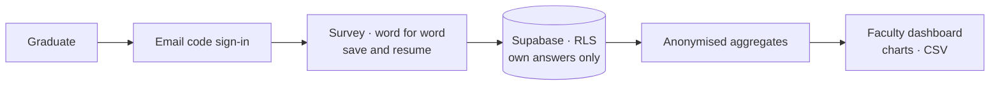

  
  
  
  

<em>An alumni tracking site for Fenerbahçe University's First and Emergency Aid programme: 
where our paramedic graduates go, and how their training holds up in the field.</em>

## What it will be

Programmes need to know what happens to their graduates. Today that is a paper or PDF survey that is hard to send, hard to fill and hard to analyse. This project turns it into a small, focused website: graduates sign in with a one-time email code, answer the programme's survey and update it later; the faculty sees the results as live, anonymised summaries.

> **Where it stands.** The project is in planning; there is no application code yet. The decisions below are agreed, the original survey has been collected, and a list of open questions has gone to the teaching staff. Building starts once their answers are in. The banner shows the intended flow as a concept.

## Decisions so far

| | |
|---|---|
| **Sign-in** | A one-time code sent by email. No passwords to forget. |
| **The survey** | The programme's existing questionnaire, reproduced word for word so results stay comparable with earlier years. |
| **Stack** | A web app on Vercel with Supabase for auth and data, protected by row-level security. |
| **Look** | A warm clay palette, calm and readable on a phone. |
| **Faculty view** | Aggregated, anonymised results with charts and CSV export. |
| **Privacy** | Only what the survey asks is stored, and graduates can see and update their own answers. |

## Planned flow

| Step | Status |
|---|---|
| Scope and decisions | Done |
| Original survey collected | Done |
| Questions to the teaching staff | Sent, waiting for answers |
| Data model and RLS | Next |
| Survey screens · email sign-in | Planned |
| Faculty dashboard and export | Planned |

## Türkçe özet

**Mezun Takip Sistemi**, Fenerbahçe Üniversitesi İlk ve Acil Yardım Programı mezunlarının nerede çalıştığını, aldıkları eğitimin işlerine ne kadar yaradığını ve programın neyi değiştirmesi gerektiğini öğrenmek için hazırlanan bir anket sitesi. Mezunlar e-postaya gelen tek kullanımlık kodla giriş yapıp programın mevcut anketini birebir dolduracak ve sonra güncelleyebilecek; bölüm sonuçları anonim özet grafikler olarak görecek. Kararlar: e-posta koduyla giriş, Vercel + Supabase, kil rengi tema, anketin aynen korunması. Proje planlama aşamasında; öğretmenlere gönderilen soruların cevapları bekleniyor.

 

GPL-3.0 · in planning · the banner is a concept with placeholder questions and numbers.

