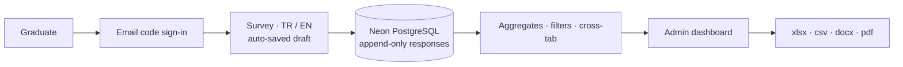

<div align="center">


<p>
  
  
  
  
</p>

<p><em>An alumni tracking site for Fenerbahçe University's First and Emergency Aid programme:<br>
where our paramedic graduates go, and how their training holds up in the field.</em></p>

</div>


## What it is

Programmes need to know what happens to their graduates. Today that is a paper or PDF survey that is hard to send, hard to fill and hard to analyse. This site replaces it: graduates sign in with a one-time email code, answer a 30-question survey in Turkish or English, and can come back every period to answer again. The teaching staff sign in to an admin area with charts, cross-tabs and four export formats.

> **Where it stands.** The application is built and deployed on Vercel with a Neon database. Before it opens to graduates it still needs real admin credentials, an outgoing mail account, the official KVKK notice and the graduate list from the teaching staff. See [`docs/KALAN-ISLER-DEVIR.md`](docs/KALAN-ISLER-DEVIR.md). The banner above is a concept illustration with placeholder numbers.


## What is in it

| | |
|---|---|
| **Sign-in** | Full name, student number, personal email, graduation year and term, then a 6-digit code by email (valid 10 minutes, 5 wrong tries counted atomically, throttled per email and per IP) and a KVKK consent box. No passwords for graduates. When the KVKK notice changes, graduates re-accept it at their next sign-in. |
| **The survey** | 30 questions in 5 sections, Turkish and English, built for phones: full-width choice rows, a fixed back/next thumb bar, a progress band. Drafts save automatically (also when the tab goes to the background) and resume at the first unfinished section. Answers are validated against the survey definition on the server. A submitted answer is never edited; a database index stops double submissions. Each answer belongs to a period (for example `2026-Guz`). |
| **Admin area** | Overview with KPIs, per-question charts, a two-question cross-tab, a response browser, a graduate list (Excel template, import with a preview, edit, KVKK anonymisation, batched reminders) and settings (period rules, access list, KVKK text, admins, own password, audit log). Roles: `owner` can change things, `viewer` can only read. Analysis screens never receive names or emails. |
| **Reports** | Excel (`.xlsx`), CSV with a UTF-8 BOM for SPSS, Word (`.docx`) and a PDF with charts, in both languages. Anonymous export is the default; CSV cells that start with a formula character are escaped. |
| **Look** | "Fildişi Kâğıt": ivory paper and warm-charcoal dark theme (light / dark / system), one clay accent, serif headings, engraved illustrations with light and dark variants. Mobile first: thumb navigation and 48 px touch targets. |
| **Safety** | Signed HTTP-only cookies with server-side revocation (logout and password change end every session), `scrypt` hashes, login throttling per email + IP, role checks on every write endpoint, size-limited request bodies, CSP and security headers, verified TLS to the database, an audit log and a daily cleanup cron. |


## How it fits together



Next.js 16 (App Router) with React 19, TypeScript and Tailwind CSS v4. Data goes through `pg`; versioned migrations in `db/migrations/` are applied once per server instance through `db/core.mjs` (shared with the scripts), and the survey definition is re-synced only when its file changes. Mail goes through Resend or SMTP (`src/lib/mail.ts`); without either it logs to the console in development. The survey itself lives in `data/surveys/mezun-bilgi-2026.json`.

## Run it locally

```bash
npm install
cp .env.example .env     # DATABASE_URL, SESSION_SECRET, admin owner, mail settings
npm run dev              # http://localhost:3000
npm run check            # tsc + eslint + vitest
npm run db:migrate       # apply migrations (add -- --demo for sample data, never in production)
npm run art              # turn Gemini drawings in assets-src/illustrations into transparent WebP
```

A PostgreSQL 16 database is required. `docker-compose.yml` and the `Dockerfile` run the whole stack on a home server instead; see [`docs/DEPLOY-MACMINI.md`](docs/DEPLOY-MACMINI.md). In development, when no mail provider is set, the code is printed to the console and shown on the page. Production never does this.

## Project notes

| File | What is in it |
|---|---|
| [`docs/PLAN.md`](docs/PLAN.md) | Scope, decisions and phases |
| [`docs/DEVIR-NOTU.md`](docs/DEVIR-NOTU.md) | Full hand-over: what was built and why |
| [`docs/KALAN-ISLER-DEVIR.md`](docs/KALAN-ISLER-DEVIR.md) | What is still open |
| [`docs/acik-sorular.md`](docs/acik-sorular.md) | Questions waiting on the teaching staff |
| [`docs/INCELEME-RAPORU-2026-11-17.md`](docs/INCELEME-RAPORU-2026-11-17.md) | Security and performance review |
| [`docs/PLAN-V2.md`](docs/PLAN-V2.md) | v2 plan: review fixes and redesign |
| [`docs/GEMINI-GORSEL-PROMPTLARI.md`](docs/GEMINI-GORSEL-PROMPTLARI.md) | Illustration prompts for Gemini |


## Türkçe özet

**Mezun Takip Sistemi**, Fenerbahçe Üniversitesi İlk ve Acil Yardım Programı mezunlarının nerede çalıştığını, aldıkları eğitimin işlerine ne kadar yaradığını ve programın neyi değiştirmesi gerektiğini öğrenmek için hazırlanan bir anket sitesi. Mezunlar ad-soyad, öğrenci numarası ve kişisel e-postalarına gelen 6 haneli kodla giriş yapıp Türkçe veya İngilizce 30 soruluk anketi doldurur; gönderilen yanıtlar hiçbir zaman silinmez ve her dönem yeniden doldurulabilir. Öğretmenler yönetici panelinde grafikleri, iki soruluk çapraz tabloyu ve yanıtları görür; sonuçları Excel, CSV, Word ve PDF olarak indirir. Altyapı Next.js 16, Neon PostgreSQL ve Vercel. Canlıya açılmadan önce gerçek yönetici hesabı, e-posta hesabı, resmi KVKK metni ve mezun listesi bekleniyor.

<div align="center">
<br>
<a href="https://github.com/kutluhangil"></a>
<sub>GPL-3.0 · pre-launch · the banner is a concept with placeholder questions and numbers.</sub>
</div>
